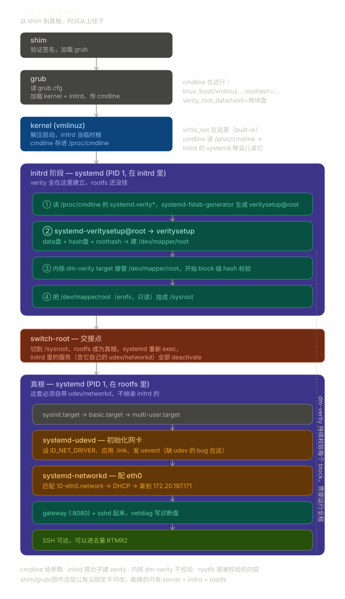

# TDX、dm-verity、erofs、mkosi、initrd→switch-root、systemd-networkd、udev、net_setup_link、ID_NET_DRIVER、诊断盘可观测性：verity rootfs 在 TD 上从启动到网络打通的调试全过程

这份文档记录 Phase 3（可复现 verity rootfs 构建完成）之后，把镜像放到真 TDX 实例上启动、最后打通网络的整个过程。

机器背景：TD 实例，公网 39.96.27.40，内网 172.20.197.171，Ubuntu 24.04.4，kernel 6.8.0-117-generic。四块盘——系统盘（原版 Ubuntu，能正常启动，作为调试基地）、erofs 数据盘、verity hash 盘、一块空白诊断盘。



---

## 一、起点与目标

### Phase 3 产出了什么

mkosi 把一棵 Ubuntu noble 的 rootfs 构建成 directory，再由 postoutput 脚本转成只读 erofs，对 erofs 做 dm-verity，得到一个稳定的 root hash。同时 mkosi 自动产出一个独立 initrd（里面带 dm-verity、erofs 内核模块和 systemd-veritysetup）。rootfs 里塞了一个静态编译的 Go gateway（监听 :8080，提供 /hello 和 /attestation）。

固定下来的几个 verity 基线：erofs UUID `11111111-2222-3333-4444-555555555555`（LABEL zeroseal_root）、verity UUID `66666666-7777-8888-9999-aaaaaaaaaaaa`、salt `0123…`（64 hex）、sha256、4096/4096 block。

### Phase 4 要验证的信任链

目标是证明这条链：

```
gateway 二进制内容 → erofs 字节 → verity root hash → grub cmdline 里的 roothash → 启动时 measure 进 RTMR2
```

也就是说，二进制改一个字节，root hash 变，cmdline 变，RTMR2 就该跟着变。这个变化本身就是“机器跑的确实是我声明的那份代码”的证据。

### 启动方式：可以换的部分

公有云的 TDVF（固件）、shim、grub 是阿里云那边固定的，改不了，也不该改（改了 MRTD/RTMR0 就对不上）。能换的只有 kernel、initrd、rootfs。

>   cmdline 也可以完全控制：具体到机器，这串文本的源头是 `/etc/grub.d/40_custom` 里那行 `linux /boot/vmlinuz-... systemd.verity=1 roothash=... `。`update-grub` 把 `40_custom` 编译进 `/boot/grub/grub.cfg`，grub 启动时读 grub.cfg 里的 `linux` 那行，把内核路径后面那串原样交给内核。grub 一个字都不改，它只负责把写在配置里的东西传过去。

本次试验实际采用的是一种混合启动（后面要换成 UKI 形式，内核也来自镜像）：grub 从宿主机系统盘的 `/boot` 加载 `vmlinuz-6.8.0-117-generic`（宿主机自带的内核）和 mkosi 产出的 initrd，然后 verity 把 erofs 挂成只读根。这个混合的细节后面会用到——如“grub 加载的内核”和“rootfs 里的模块树”是两个独立的东西。

---

## 二、可观测性的建立

在 TD 上，常规的观察手段几乎用不了：

- VNC 不支持。报错“该资源目前的状态不支持此操作"。原因是 VNC 会触碰 vCPU 寄存器状态，跟 TD 的 RTMR/度量模型冲突。
- 控制台的调试日志不可靠。它只稳定显示固件阶段的日志，会缓存旧截图，还会截断或者崩溃不可用。靠它看内核之后的启动过程基本不行。
- SSH 连不上。不过这个是此次调试的原因，即网络为何不通。

结论：在能 SSH 之前，要造一个不依赖网络、不依赖控制台的观察方式。

### 诊断盘机制

办法是挂一块空白盘，写一个 netdiag.service 在系统起到 multi-user 之后启动该服务，把当时的网络状态、服务状态、日志收集起来，用 `dd` 直接写进那块裸盘（不走文件系统，直接覆盖块设备的前若干 MB）。然后控制台关机、重启回原版 Ubuntu，从原版 Ubuntu 那边把诊断盘的前 1MB `dd` 出来，`strings` 提取，看 `NETDIAG START`…`NETDIAG END` 之间的内容。

读盘命令：

```bash
sudo dd if=/dev/disk/by-id/nvme-Alibaba_Cloud_Elastic_Block_Storage_2zeavftaydf47iwtfa4g \
  bs=1M count=1 2>/dev/null | strings | sed -n '/NETDIAG START/,/NETDIAG END/p'
```

### grub 一次性引导与重启时回归原系统的调试机制

grub-reboot 设置的 `next_entry`（写在 `/boot/grub/grubenv`）只生效一次，被首次启动消费掉。所以一次失败的镜像启动之后，机器会自动 fallback 回原本的 Ubuntu 系统。这意味着：哪怕 verity 镜像启动崩了、网络不可达，下次重启也总能自动回到能读诊断盘的原版 Ubuntu。诊断盘 + grub 一次性引导，两者配合让「重启-访问诊断盘」这个循环成立。

#### 机制的来源

使用「重启-访问诊断盘」机制前经历了三个阶段，每个阶段卡住的原因都不一样：

1. 第一版 netdiag 的依赖是 `After=multi-user.target`（multi-user 对应服务器的最后 target（target 是一个抽象的里程碑）。对于 GUI 界面，后续还有一个 graphical 的 target）。但当时启动卡在 multi-user 之前（wait-online 卡死，见下一节 bug 3），netdiag 根本没机会跑，诊断盘一直空。
2. 修掉 wait-online 后，启动到了 multi-user，netdiag 跑了，但它往 `/tmp/netdiag.txt` 写中间结果——verity 根是只读的，`/tmp` 不是 tmpfs，写失败，后面 `dd` 到盘的代码没执行（bug 4）。诊断盘还是空。
3. 把 netdiag 改成收集进 shell 变量（内存里）、直接 `echo "$OUT" | dd` 到盘、完全不碰 `/tmp`，诊断盘才终于稳定出数据。

教训：可观测性工具本身也会有 bug，而且它的 bug 会伪装成"被观察对象没问题"。诊断盘一直空，前两个阶段都误以为是"没到 multi-user"，其实第二阶段已经到了，只是写盘失败。

---

## 三、四个 boot bug

从 mkosi 构建成功到镜像能跑到 multi-user，连续踩了四个 bug。每个都是单独一次启动暴露的。这一节按时间顺序。。

### Bug 1：mkosi 构建末尾 `No module named 'pefile'`

> 现象：mkosi build 跑到 bootloader 处理阶段报 `ModuleNotFoundError: No module named 'pefile'`

要看 mkosi 的 `python_binary()` 逻辑：当不用 tools tree、且 mkosi 自身的解释器不在 `/usr` 下时，它在 sandbox 里调用的是字符串 `"python3"`（即系统的 `/usr/bin/python3`）。因为 mkosi 是从 venv 跑的，`sys.executable` 不在 `/usr` 下，于是 sandbox 用系统 python3，而系统 python3 没装 pefile。

往 venv 里装 pefile 没用——sandbox 用的不是 venv 的 python。

解决：改用 tools tree。mkosi 的默认 ubuntu tools tree 自带 `python3-pefile`、`erofs-utils`、`libcryptsetup12`，但不带 veritysetup，所以额外加 `ToolsTreePackages=cryptsetup-bin`。

```ini
[Build]
ToolsTree=default
ToolsTreeDistribution=ubuntu
ToolsTreeRelease=noble
ToolsTreePackages=cryptsetup-bin
```

知识点：mkosi 在 sandbox 里跑构建，sandbox 的工具来源（系统 python vs tools tree）决定了哪些库可用。tools tree 是 mkosi 推荐的做法，因为它把构建工具和宿主机隔离，可复现性也更好。

### Bug 2：grub `error: file '/vmlinuz-6.8.0-117-generic' not found`

> 现象：首次 verity 启动，grub 报找不到 `/vmlinuz-…`，接着 `you need to load the kernel first`

根因是个文件路径错误，但要先搞清楚磁盘布局才能看懂。系统盘的 part3 是 root 分区（ext4），`/boot` 是这个 root 分区下的一个普通目录，不是独立分区。所以 kernel 的真实路径是 `/boot/vmlinuz-…`。但 menuentry 里写的是 `/vmlinuz-…`（少了 `/boot` 前缀）。

判断"/boot 是目录还是独立分区"的方法：`findmnt /boot`，或看 `/etc/fstab` 里有没有单独给 `/boot` 的条目。如果 `/boot` 是独立分区，grub 的 root 会被设到那个分区，路径就不带 `/boot`；如果是目录，路径必须带。

解决：menuentry 改成 `linux /boot/vmlinuz-6.8.0-117-generic …` 和 `initrd /boot/zeroseal.initrd`。

注意，上面 `/boot/vmlinuz-6.8.0-117-generic` 是 host 机的内核，这就是混合方案的来源。

------

### Bug 3：启动卡死在 systemd-networkd-wait-online

此时 SSH 不通，诊断盘也没数据——它要 multi-user 之后 netdiag 才写，而这轮卡在 multi-user 之前，netdiag 没跑成。这一轮的定位证据只有一个来源：console 启动日志。

#### 日志停在哪一行

那轮 console 日志，正常的 `[ OK ] Started …` 一条条往下走,到某条之后不再有新的 `Reached target`,卡住的是这条，计时一直在涨：

>   ```
>   [*] A start job is running for systemd-networkd-wait-online.service (1min 33s / no limit)
>   ```

可以推断的是：

-   卡在 `systemd-networkd-wait-online.service`。
-   `1min 33s`——这个 job 跑了一分半还没完成。
-   `no limit`——没有超时上限。对比别的服务卡住会显示 `(30s / 1min 30s)` 这种“已用 / 上限”，到上限就被 systemd 杀掉放行。`no limit` 表示它会一直等，永不超时。

>   据 AI 所言，systemd-networkd-wait-online 只是一个等待器，等待 systemd-networkd.service 主服务枚举网卡、匹配 .network、发 DHCP、配地址（另外，常驻运行，是 daemon）。当时根据因 sshd，gateway 等服务不需要等待网络完成就可以起服务，再加上后验因 udev 导致 systemd-networkd.service 的网卡 ip 配置迟迟没结束（严格来说，是 networkd 管理的网卡至少一个进入 configured（配好 IP）或明确 failed。目前是网卡始终没到达 configured 这个状态，这也是 wait-online 的终止条件），systemd-networkd-wait-online 无限阻塞，所以在调试网络时将这个服务 masked 了。最后应在解决网络服务后将其恢复，避免之后新增其他服务时遗忘这个 masked，而这个服务需要网络可行先行。另外，由于 service 在 `/usr/lib/systemd/system/` 目录下，所以也该恢复，不然 root hash 会变。

#### 以及，它后面该出现的行没出现

同一段日志里，wait-online 那行之后，再没有 `Reached target multi-user.target`，也没有 netdiag 启动。

对照下一轮（修掉 wait-online 之后）的日志，这几行是有的：

>   ```
>   [ OK ] Reached target multi-user.target
>          Starting netdiag.service...
>   ```

故 wait-online 那轮，`multi-user.target` 始终没到达，netdiag 始终没启动。

#### 那为什么卡在 wait-online

-   systemd 文档中提及，wait-online 的职责是 networkd 管理的网卡至少一个进入 configured（配好 IP）或明确 failed。
-   一个潜在的推论是：eth0 没配上 IP → wait-online 的放行条件不满足 → 它又 `no limit` → 无限等。

延伸一下推论，最终的逻辑链是：

```
wait-online 无限等（日志: 那行在涨、no limit）
  → multi-user 到不了（日志: 缺 Reached target multi-user）
  → 排在 multi-user 后的 netdiag 不跑（日志: 缺 Starting netdiag）
  → 诊断盘空
```

#### 修复的两步以及各自的理由

那么对于这个推论来说，一个可执行的操作是别让 wait-online 挡在 multi-user 前面。

第一步，gateway 去掉 `network-online.target` 依赖。`network-online.target` 这个 target 靠 wait-online 来兑现（wait-online 跑完它才算达成）。谁 `Wants/After=network-online.target`，谁就把 wait-online 拉进了自己的启动依赖。gateway 当时挂了这个，等于要求“网络真就绪”。后面就去掉了它，改用 `Restart=on-failure` 自己重试，不等网络。

第二步，mask 掉 wait-online。

```bash
ln -sf /dev/null overlay/usr/lib/systemd/system/systemd-networkd-wait-online.service
```

`ln -sf /dev/null` 把这个 service 指向空（突然意识到，overlay 上的东西也不能太多，不然很难做审查。找时间过一遍 overlay）。

#### 确认没有别的东西拉 wait-online

mask 掉之后，要确认没有服务还在通过 `network-online.target` 把 wait-online 拉回启动链。在 Ubuntu 上查 mkosi 的 rootfs 文件树：

```bash
# ~/zeroseal-mkosi/
ls -la zeroseal/usr/lib/systemd/system/network-online.target.wants/ 2>/dev/null
# 结果：没有这个目录

grep -rl 'network-online' zeroseal/usr/lib/systemd/system/
# 结果：只有 systemd-networkd-wait-online@.service（带 @ 的模板）
#       和 systemd-networkd.service（networkd 自己）
```

两条结果说明"没有别的服务拉它"：

-   没有 `network-online.target.wants` 目录 → 没有任何服务通过这个标准机制声明"我要等网络在线"。
-   grep 出的两个文件：`systemd-networkd-wait-online@.service` 带 `@`，是模板单元，要被实例化成 `…@eth0.service` 才会跑，光模板不跑；`systemd-networkd.service` 提 network-online 是声明"我提供这个能力"，不是"我要等它"。

但这里并没有说明为什么 multi-user.target 被 systemd-networkd-wait-online.service 卡了。问题实际在最初弄错的 gateway 上。`WantedBy=multi-user.target` 使得 multi-user.target 得等待 gateway.service 等所有 wantedby 的 unit 进入终止态才会终止。而 network-online（`Type=oneshot`，进程跑完根据 ExitCode 决定终止态为 done or failed）的进程一直不结束，导致了 multi-user.target 一直被卡。

```ini
# 2. gateway.service
cat > overlay/usr/lib/systemd/system/gateway.service << 'EOF'
[Unit]
Description=ZeroSeal gateway
After=network-online.target
Wants=network-online.target

[Service]
ExecStart=/usr/local/bin/gateway
Restart=on-failure

[Install]
WantedBy=multi-user.target
EOF
```

所以第一步去掉 network-online 的依赖是恰好解除 multi-agent 死锁的问题。

### Bug 4：netdiag 写 `/tmp` 失败（诊断盘一直空的真因）

> 现象：到了 multi-user，但 netdiag 报 `/usr/local/bin/netdiag.sh: line 36: /tmp/netdiag.txt: Read-only file system`

这是前面诊断盘一直读不出东西的真正原因。verity 根是只读 erofs，`/tmp` 又没被挂成 tmpfs，所以往 `/tmp` 写中间文件直接失败，后面 `dd` 到诊断盘的代码根本没执行。

解决：netdiag 不落地任何临时文件，收集进 shell 变量，直接管道 `dd`：

```bash
OUT=$(collect 2>&1)                          # 收集进内存变量
echo "$OUT" | dd of="$DIAGDISK" bs=1M conv=fsync 2>/dev/null   # 直接写裸盘
echo "$OUT" > /dev/console                   # 同时打到 console 兜底
```

知识点：只读根文件系统下，凡是默认往磁盘写东西的程序都要重新审视。`/tmp`、`/var` 这些常被假设可写的路径，在 verity 根下都不可写。这同样解释了后面 VSCode Remote-SSH 装不上（它要往远端 `$HOME` 写 server 组件）。

---

## todo 四、网络打不通：假说-验证循环

镜像能跑到 multi-user 之后，真正难的部分开始：SSH 连不上，内网 8080 也连不上。这一节是整个调试里假说最多、推进最曲折的部分。把它完整记下来，因为"怎么从一个模糊现象一步步逼到根因"这个过程，比"根因是缺 udev"这个结论更值得复用。

### 现象的第一次成像

诊断盘第一次出有效数据时，看到的关键事实：

```
eth0: <BROADCAST,MULTICAST> mtu 8500 qdisc noop state DOWN
ip route：   （空）
networkctl： Failed to connect to system bus: No such file or directory
```

`qdisc noop` + `state DOWN` 是网卡没人管理的状态——`noop` 是内核给无人接管的网卡挂的占位队列。`networkctl` 连不上 system bus，是因为没装 dbus，且 netdiag 跑得早。所以 networkctl 这个客户端工具全程用不了，只能靠 `ip`、`/sys`、`/run/systemd/netif/` 这些不依赖 dbus 的东西。

networkd 的日志只有：

```
lo: Link UP
lo: Gained carrier
Enumeration completed
（之后对 eth0 一个字都没有）
```

networkd 枚举完只处理了 lo，对 eth0 完全没动作。这是贯穿整个排查的主线现象。

### 假说逐个排除

假说 A：`.network` 配置没生效。
查：文件在 `/usr/lib/systemd/network/10-eth0.network`，内容正确（`[Match] Name=eth0`、`DHCP=ipv4`）。`/etc/systemd/network/` 空，没有更高优先级的覆盖。其它 `80-*.network` 的 Match 都是 veth/wlan/tun 之类，不抢 eth0。配置本身没问题，排除。

假说 B：virtio_net 模块缺失。
查：rootfs 的 `drivers/net/` 下确实没有 `virtio_net.ko`。但这里有个岔路——宿主机上也找不到 `virtio_net.ko` 文件，可宿主机 eth0 是好的。原因是宿主机 `CONFIG_VIRTIO_NET=y`，编进内核了（built-in），不是独立模块。再查：grub 加载的 `vmlinuz-6.8.0-117-generic` 跟宿主机正在跑的内核是同一个文件（同样 15034760 字节、同一日期）。既然是同一个 built-in virtio_net 的内核，rootfs 启动时驱动必然在内核里。排除"驱动缺失"。

这一步的方法论：rootfs 里的模块树和 grub 加载的内核是两个独立的东西。virtio_net 是 built-in，只跟 vmlinuz 有关，跟 rootfs 的 `/lib/modules` 无关。不把这两者分开，会在"模块树里没有 virtio_net"上浪费很多时间。

假说 C：驱动没问题，是 networkd 没去配。
做实验：netdiag 里加 `ip link set eth0 up`。结果拉 UP 立刻成功（`DOWN → UP`，`noop → mq`），而且 networkd 立刻感知到：

```
eth0: Link UP
eth0: Gained carrier
```

证明驱动、设备、carrier 全正常，networkd 也在监听这个设备，只是它没主动去配 eth0、没发 DHCP。

假说 D：networkd 没发 DHCP4。
手动 `systemctl restart systemd-networkd`，重启后 eth0 拿到了 carrier，但只有 `inet6 fe80::…`（IPv6 链路本地地址，内核自己配的，不需要 DHCP），没有 IPv4。说明即使 networkd 重新跑一遍，它对 eth0 的处理还是不完整。

这一步还踩了个坑：有一版 netdiag 里加了 `networkctl reconfigure eth0`，结果 netdiag 直接卡死，诊断盘留了旧数据。原因是 `networkctl` 走 dbus，而 netdiag 跑得早、dbus 没起，命令阻塞。教训：诊断脚本只做只读观察，不要承担修复动作（restart / reconfigure 这些都可能卡）。把诊断和修复混在一起，会让"脚本卡死"和"被观察对象有问题"难以区分。

### 用 /run/systemd/netif 看 networkd 的内部判断

把诊断盘的观察点换到 `/run/systemd/netif/links/`，拿到了决定性信息：

```
ADMIN_STATE=pending
OPER_STATE=carrier
CARRIER_STATE=carrier
ADDRESS_STATE=off
IPV4_ADDRESS_STATE=off
```

`ADMIN_STATE=pending` 是 networkd 对这个网卡"还没完成配置"的标记。它有 carrier、networkd 也记录了，但停在 pending，没进入"匹配 .network → 应用 → 发 DHCP"的流程。

这个观察点比 networkctl 可靠：`/run/systemd/netif/links/` 是 networkd 直接写的文件，读它不需要 dbus。在没有 dbus 的环境里，这是看 networkd 内部状态的正路。

### web 调研 + 阿里云文档

到这里现象很清楚但根因还没定，转去查 systemd 官方 issue：

- issue #27718：networkd 在 initrd 里启动，switch-root 后被 deactivate，不会自动重启，导致重启后没网络。机制对得上——你的镜像 initrd 里也跑 networkd。
- issue #21105：udev 想给网卡改名，但 networkd 抢先把接口 up 了，导致 `Failed to rename … Device or resource busy`，网卡卡在"被看见但没配置"的坏状态。

阿里云官方文档给了另一条线索：ECS 的网卡配置示例用 MAC 地址匹配（`match: macaddress`），不是接口名匹配。原因是在 initrd→switch-root 这个过程里，接口名 `eth0`（靠 `net.ifnames=0` 重命名）的确立和 networkd 枚举之间存在竞争，MAC 在设备一出现就固定，不依赖重命名时序。

于是加了 MAC 匹配 + 一条 udev 规则（virtio_net 设备 add 时 restart networkd）。结果：还是 pending，而且 networkd 日志里没有任何 restart 痕迹——udev 规则根本没触发。

### 关键转折：ID_NET_DRIVER 没被设置

udev 规则没触发这件事，反过来是个强线索。规则的条件是 `ENV{ID_NET_DRIVER}=="virtio_net"`。`ID_NET_DRIVER` 这个 udev 属性，是 udev 的 net_setup_link 内建规则跑过之后才会打上的。如果它没被设置，规则条件永远不匹配。

顺着这条线查 rootfs 的 udev 规则目录，只有 5 个文件，没有任何 net 相关规则。再往下查，发现更根本的事实：

```
zeroseal/usr/lib/systemd/systemd-udevd: No such file or directory
zeroseal/usr/bin/udevadm: No such file or directory
```

rootfs 根本没装 udev。

### 根因与修复

systemd 和 udev 在 Ubuntu 是两个独立的包。mkosi.conf 的 Packages 里只有 systemd，没有 udev，所以 rootfs 没有 udev。

没有 udev 的后果是一条完整的链：网卡 probe 出来后，没有任何东西去设 ID_NET_DRIVER、应用 .link 配置、确立接口名、发 uevent 通知 networkd。networkd 枚举时看到的是一个没被初始化的裸设备，于是卡在 pending。这同时解释了之前所有现象——ID_NET_DRIVER 没设（udev 规则不匹配）、networkd 不配 eth0、手动 restart 也只能拿到 IPv6LL（那是内核配的，不经 udev）。

启动日志里之所以有 systemd-udevd 在跑，那是 initrd 里的 udev。switch-root 到真根后，真根没有 udev，udevd 就停了。真根里网卡无人初始化。

修复是一行：

```ini
# mkosi.conf 的 [Content] Packages 段加上 udev
Packages=
  systemd
  bash
  openssh-server
  iproute2
  udev
  linux-image-6.8.0-117-generic
```

重启后 eth0 拿到 `inet 172.20.197.171/20 metric 100 dynamic`（`metric 100` 正是 `10-eth0.network` 里 `RouteMetric=100` 生效的证据），SSH 报 host key changed（连上了，只是主机密钥从原版 Ubuntu 变成了镜像里打进去的那套）。加了 udev 之后，之前的 MAC 匹配也一起正常工作了，那条 udev restart 补救规则不再需要，删掉。

---

## 五、涉及的系统机制

把这次用到的系统知识集中沉淀，按从下到上的启动顺序排。

### TDX boot chain

```
TDVF（固件）→ shim → grub → kernel + initrd → systemd（PID 1）
```

公有云上 TDVF/shim/grub 固定不可改，能换的只有 kernel、initrd、rootfs。这条链被 measure 进 RTMR0–2，是后面验证 attestation 的对象。MRTD 测 TDVF，RTMR 测后续。固件层改了，度量基线就对不上，所以混合启动只动 kernel 之后的部分。

### dm-verity + erofs

erofs 是只读压缩文件系统，存数据。dm-verity 在它之上建一棵 hash 树，root hash 进 grub cmdline。运行时每读一个 block 都校验 hash，对不上就按 `panic-on-corruption` 处理。效果是 rootfs 任何一个字节变了，root hash 必然变，启动就会失败或触发 panic。这是"运行的就是声明的那份内容"的技术保证。

只读这个性质有一串连带影响：`/tmp`、`/var` 默认不可写（bug 4）、VSCode Remote-SSH 装不上 server、任何想往根写东西的程序都要重新设计。

### systemd 启动 target 链与 switch-root

```
initrd 阶段（initrd.target）→ initrd-switch-root → sysinit.target → basic.target → multi-user.target
```

verity 的挂载发生在 initrd 阶段：`systemd-veritysetup@root` 打开 verity 设备成 `/dev/mapper/root`，挂成 `/sysroot`，然后 switch-root 切过去。

switch-root 是个关键节点：initrd 里跑的是一套 systemd（含它自己的 networkd、udevd），switch-root 时 systemd 重新 exec，initrd 里的服务被 deactivate。真根必须自己有完整的 udev、networkd——不能指望 initrd 里那套延续过来。这次的根因（真根缺 udev）正是踩在这个交接点上。

### systemd-networkd 状态机

networkd 的处理流程：enumerate（枚举当前已存在的网卡）→ 对每个网卡按文件名顺序匹配 `.network` → 应用配置 → 按配置发 DHCP / 配静态 IP。

`/run/systemd/netif/links/` 里的状态字段含义：

- `ADMIN_STATE=pending` → networkd 还没完成对这个网卡的配置
- `OPER_STATE` / `CARRIER_STATE=carrier` → link 起来了、有载波
- `IPV4_ADDRESS_STATE=off` → 没配上 IPv4（没发 DHCP 或没拿到）
- `configured` / `routable` → 正常配好的状态

读这些文件不需要 dbus，是没装 dbus 时观察 networkd 的可靠手段。networkctl 走 dbus，没 dbus 就用不了。

`.network` 的目录优先级：`/etc/systemd/network/` > `/run/systemd/network/` > `/usr/lib/systemd/network/`。文件名数字越小优先级越高（`10-` 比 `80-` 先匹配）。

### udev 在网卡初始化中的角色

网卡被内核 probe 出来后，udev 负责把它变成"可用"状态：

- net_setup_link 内建命令：设 `ID_NET_DRIVER`、应用 `.link` 文件、确立最终接口名
- 发 uevent 通知 networkd"有这么个设备、它已经初始化好了"

没有 udev，网卡停留在裸设备状态——内核认得它（`/sys/class/net/eth0` 在、driver 也是 virtio_net），但 ID_NET_DRIVER 没设、接口名/属性不完整、networkd 收不到"设备就绪"的通知。networkd 枚举时即使看到这个 link，也不会进入完整配置流程。

networkd 和 udev 的关系：networkd 依赖 udev 把设备初始化好并通过 uevent 通知。MAC 匹配能绕开"接口名还没确立"的竞争，但绕不开"设备压根没被 udev 初始化"——这就是为什么这次光加 MAC 匹配没用。

---

## 六、复盘与下次的排查路径

### 为什么本体 Ubuntu 没事，镜像一直卡

本体 Ubuntu 和镜像在网络栈上差三点，叠加起来导致镜像触发了本体不会遇到的问题：

- 本体用 cloud-init / netplan + 完整 udev，正常磁盘启动。网卡初始化、DHCP、重试都由这套成熟流程处理。
- 镜像用裸 systemd-networkd，缺 udev，而且经过 initrd→switch-root 的网络栈交接。

本体没暴露这个问题，是因为它有 udev（网卡正常初始化），也不用"裸 networkd + 设备晚到 + 缺 udev"这个组合。对比正常系统和异常系统的差异，差异点就是排查方向——这次"本体能 SSH、镜像不能"的对比，从一开始就指向"镜像的网络栈缺了本体有的某样东西"。

### 网卡不通时的分层排查

下次遇到网卡问题，按这个分层从下往上查，每层用不依赖上层的工具：

- 设备层：`ls /sys/class/net/`、`lsmod` / `/proc/modules`、`cat /sys/class/net/eth0/device/driver`。驱动在不在、设备 probe 出来没。
- link 层：`ip link show eth0`。`state UP` 还是 `DOWN`、`qdisc` 是 `noop`（无人管）还是正常队列、有没有 carrier。
- 地址层：`ip addr show eth0`。有没有 `inet`（IPv4）。只有 `inet6 fe80::` 说明只有内核配的链路本地地址，DHCP 没成。
- 服务层：`ss -tlnp`。服务有没有在监听、监听在哪个地址。
- networkd 内部：`cat /run/systemd/netif/links/*` 看 ADMIN_STATE / IPV4_ADDRESS_STATE，不依赖 dbus。

### 几条可直接复用的判断

- 自定义镜像网络不通，先确认 udev 在不在。systemd ≠ udev，是两个包，mkosi/debootstrap 精简时很容易漏掉 udev。
- networkd 卡 pending + 日志只有 lo + 设备是晚到的虚拟网卡 → 高度怀疑 udev 没把网卡初始化。
- 看 networkd 状态优先用 `/run/systemd/netif/links/`，不要依赖 networkctl（它要 dbus）。
- mkosi 的 `Packages` 里装了 systemd 不等于有 udev、dbus、resolved 这些，需要的都得显式列。
- `/boot` 是目录还是独立分区，决定 grub menuentry 里 kernel 路径带不带 `/boot`，先 `findmnt /boot` 确认。
- rootfs 里的内核模块树和 grub 加载的 vmlinuz 是两个独立的东西。built-in 的驱动（`=y`）只跟 vmlinuz 有关，不在 `/lib/modules` 里找得到。

### 方法论提炼

- 先建可观测性，再谈调试。环境里 SSH 不通、VNC 不可用、console 不可靠时，第一件事是造一个不依赖这些的观察通道（这次是诊断盘）。在看不见的情况下调试，等于盲赌。
- 用证据排除，不靠猜。每个假说都配一个能证伪它的观察。这次五个假说（配置没生效、驱动缺、networkd 不配、networkd 不发 DHCP、udev 没初始化）逐个用诊断盘的数据排除，最后才落到根因。
- 静态检查能省大量重启。解包 initrd、查 rootfs 文件树、对比宿主机，这些都能在不重启的原版 Ubuntu 上做，比反复"改-重启-读盘"快得多。这次定位"缺 udev"的临门一脚，就是在 Ubuntu 上 `ls` 了一下 rootfs 的 udev 目录。
- 分清现象和根因。`ADMIN_STATE=pending` 是现象，缺 udev 是根因，中间隔了好几层可能的解释。每往下一层都要有证据支撑，不能停在第一个看起来合理的解释上。
- 诊断工具和修复动作分开。观察脚本只读、不改状态；修复单独做。混在一起时，脚本自己卡死会伪装成被观察对象的问题（这次 reconfigure 卡死就是例子）。