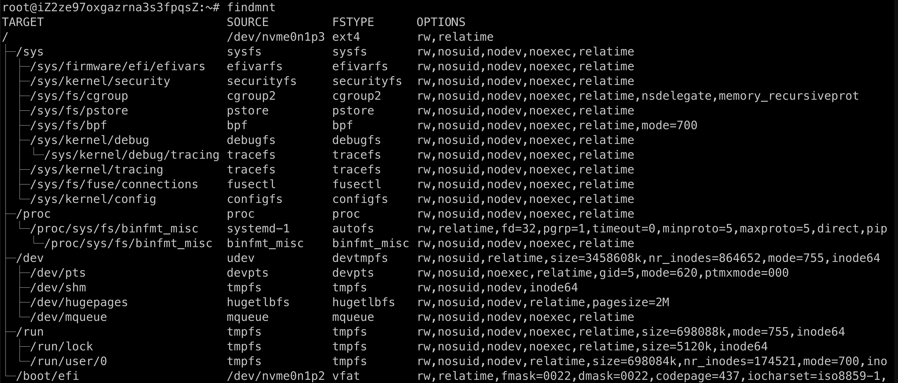

## ～

挂载点不是"管一个目录"，是接管"从这个点往下的整棵子树"，直到被另一个挂载点截断。要看真实嵌套，跑 `findmnt` 最准。下面是我的机子的 findmnt：



```bash
findmnt
TARGET                          SOURCE         FSTYPE      OPTIONS
/                               /dev/nvme0n1p3 ext4        rw,relatime
├─/sys                          sysfs          sysfs       rw,nosuid,nodev,noexec,relatime
│ ├─/sys/firmware/efi/efivars   efivarfs       efivarfs    rw,nosuid,nodev,noexec,relatime
│ ├─/sys/kernel/security        securityfs     securityfs  rw,nosuid,nodev,noexec,relatime
│ ├─/sys/fs/cgroup              cgroup2        cgroup2     rw,nosuid,nodev,noexec,relatime,nsdelegate,memory_recursiveprot
│ ├─/sys/fs/pstore              pstore         pstore      rw,nosuid,nodev,noexec,relatime
│ ├─/sys/fs/bpf                 bpf            bpf         rw,nosuid,nodev,noexec,relatime,mode=700
│ ├─/sys/kernel/debug           debugfs        debugfs     rw,nosuid,nodev,noexec,relatime
│ │ └─/sys/kernel/debug/tracing tracefs        tracefs     rw,nosuid,nodev,noexec,relatime
│ ├─/sys/kernel/tracing         tracefs        tracefs     rw,nosuid,nodev,noexec,relatime
│ ├─/sys/fs/fuse/connections    fusectl        fusectl     rw,nosuid,nodev,noexec,relatime
│ └─/sys/kernel/config          configfs       configfs    rw,nosuid,nodev,noexec,relatime
├─/proc                         proc           proc        rw,nosuid,nodev,noexec,relatime
│ └─/proc/sys/fs/binfmt_misc    systemd-1      autofs      rw,relatime,fd=32,pgrp=1,timeout=0,minproto=5,maxproto=5,direct,pip
│   └─/proc/sys/fs/binfmt_misc  binfmt_misc    binfmt_misc rw,nosuid,nodev,noexec,relatime
├─/dev                          udev           devtmpfs    rw,nosuid,relatime,size=3458608k,nr_inodes=864652,mode=755,inode64
│ ├─/dev/pts                    devpts         devpts      rw,nosuid,noexec,relatime,gid=5,mode=620,ptmxmode=000
│ ├─/dev/shm                    tmpfs          tmpfs       rw,nosuid,nodev,inode64
│ ├─/dev/hugepages              hugetlbfs      hugetlbfs   rw,nosuid,nodev,relatime,pagesize=2M
│ └─/dev/mqueue                 mqueue         mqueue      rw,nosuid,nodev,noexec,relatime
├─/run                          tmpfs          tmpfs       rw,nosuid,nodev,noexec,relatime,size=698088k,mode=755,inode64
│ ├─/run/lock                   tmpfs          tmpfs       rw,nosuid,nodev,noexec,relatime,size=5120k,inode64
│ └─/run/user/0                 tmpfs          tmpfs       rw,nosuid,nodev,relatime,size=698084k,nr_inodes=174521,mode=700,ino
└─/boot/efi                     /dev/nvme0n1p2 vfat        rw,relatime,fmask=0022,dmask=0022,codepage=437,iocharset=iso8859-1,
root@iZ2ze97oxgazrna3s3fpqsZ:~#
```

| 角色(挂载点)                | SOURCE           | 类型     | 落盘? | 你实验里碰它的地方                                           |
| --------------------------- | ---------------- | -------- | ----- | ------------------------------------------------------------ |
| `/`                         | `/dev/nvme0n1p3` | ext4     | 落盘  | 当前系统根。Phase 3 你要把含 Go 服务的根换成 squashfs+verity 形态,这是被替换的目标 |
| `/boot/efi`                 | `/dev/nvme0n1p2` | vfat     | 落盘  | EFI 系统分区,GRUB 和启动配置在这。Phase 4 改 cmdline(`update-grub`)最终落到这里影响 boot 链 measure |
| `/sys/kernel/config`        | configfs         | configfs | 内存  | 产 quote 的地方:`/sys/kernel/config/tsm/report/...`,mkdir + 读写 inblob/outblob |
| `/sys/firmware/efi/efivars` | efivarfs         | efivarfs | 内存  | UEFI 变量。boot 配置相关,排查 boot 链时可能用到              |
| `/sys`                      | sysfs            | sysfs    | 内存  | Phase 1 读 event log:`/sys/firmware/acpi/tables/CCEL`(在 `/sys` 这棵里,没被单独挖走) |
| `/dev`                      | udev             | devtmpfs | 内存  | 设备节点所在:`/dev/tdx_guest`(产 quote 的底层驱动)、`/dev/nvme0n1*`(你的云盘和分区) |
| `/proc`                     | proc             | proc     | 内存  | `cat /proc/cmdline` 看当前内核 cmdline(Phase 1)。关于 `/proc/cmdline` 在「TDX 试验清单」有额外讨论可以看下 |

**文件系统类型(你实验里一定碰到的)**

-   ext4 — 落盘类型,系统 root 分区的格式,在 `/dev/nvme0n1p*` 上
-   
-   squashfs — 落盘只读类型,你 Phase 3 要 mksquashfs 打的那个只读 rootfs 镜像
-   tmpfs / ramfs — 纯内存虚拟类型,内核早期 rootfs 和各种运行时临时目录用它
-   configfs — 内存虚拟类型,内容由内核代码生成,你产 quote 走的 `/sys/kernel/config/tsm/...` 就是它
-   sysfs — 内存虚拟类型,内核把设备/驱动状态投影成文件,挂在 `/sys`
-   proc(procfs)— 内存虚拟类型,进程和内核信息投影成文件,你 `cat /proc/cmdline` 读的就是它
-   devtmpfs — 内存虚拟类型,内核在 `/dev` 下自动建设备节点(`/dev/tdx_guest`、`/dev/nvme0n1` 这些节点就是它放的)
-   overlayfs — 联合挂载类型,容器镜像分层用,你 Phase 5 在 Docker 里复现 rootfs 时底下是它

**角色(挂载点 / 用途)**

-   rootfs — 挂在 `/` 的根。注意它有两个:内核早期的内存 rootfs(类型 tmpfs/ramfs)→ switch_root → 最终根(类型 ext4,或你实验里的 squashfs+verity)
-   `/sys` — sysfs 担任,看设备状态
-   `/sys/kernel/config` — configfs 担任,你产 quote 的地方
-   `/proc` — procfs 担任,你读 cmdline 的地方
-   `/dev` — devtmpfs 担任,所有设备节点在这
-   `/sys/firmware/acpi/...` — sysfs 的一部分,你 Phase 1 tdeventlog 读 CCEL 表的地方
-   initramfs — 不是挂载点,是塞进早期内存 rootfs 里跑的一包东西,负责 setup verity 再切到最终根(就是那个 bootstrap 缝所在)

SOURCE 不是 `/dev/xxx` 真实块设备的,就是虚拟文件系统。

`lsblk` 可看块设备，目前没有 mapper 那些虚拟的块设备。

```bash
lsblk
NAME        MAJ:MIN RM  SIZE RO TYPE MOUNTPOINTS
nvme0n1     259:0    0   40G  0 disk
├─nvme0n1p1 259:1    0    1M  0 part
├─nvme0n1p2 259:2    0  200M  0 part /boot/efi
└─nvme0n1p3 259:3    0 39.8G  0 part /
```

